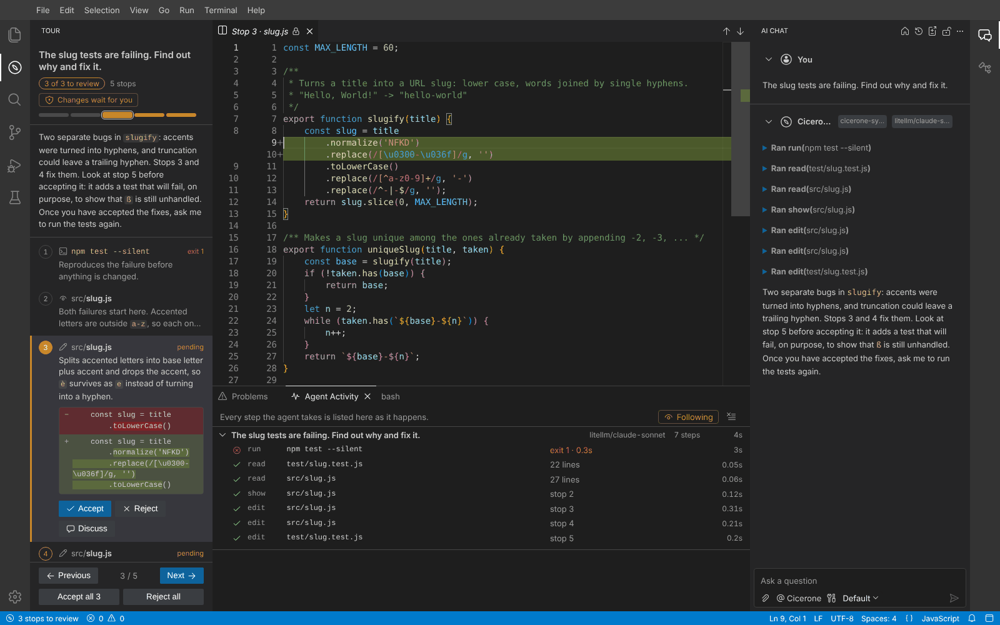
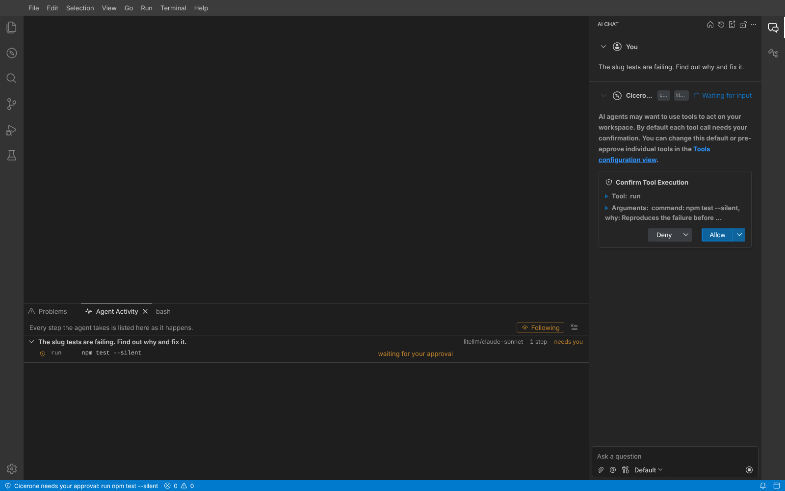
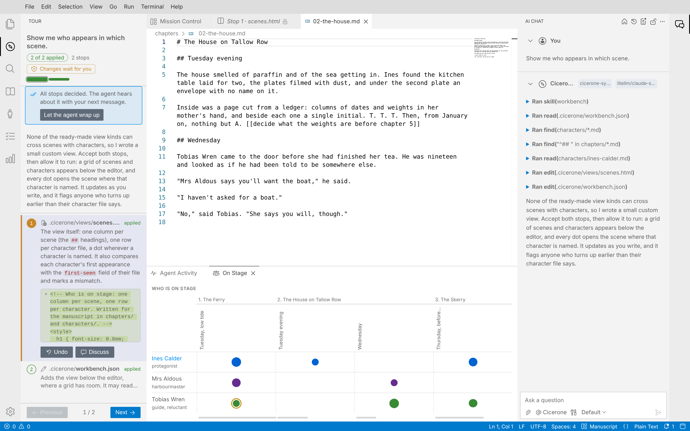
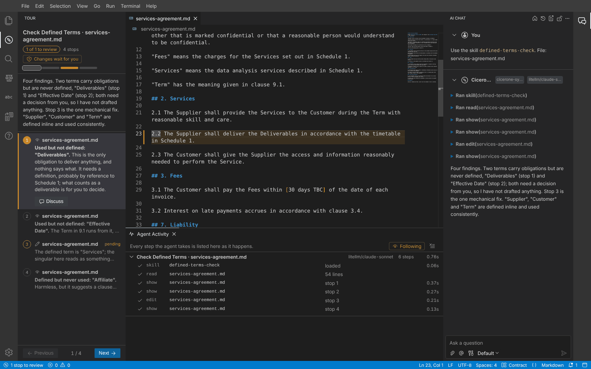
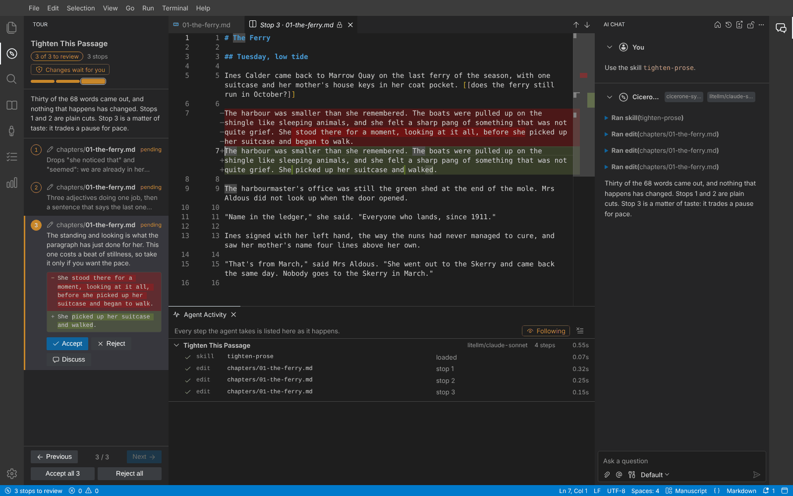
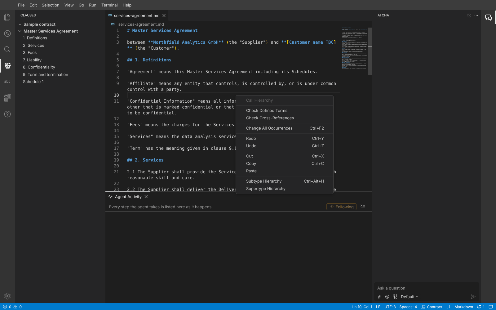
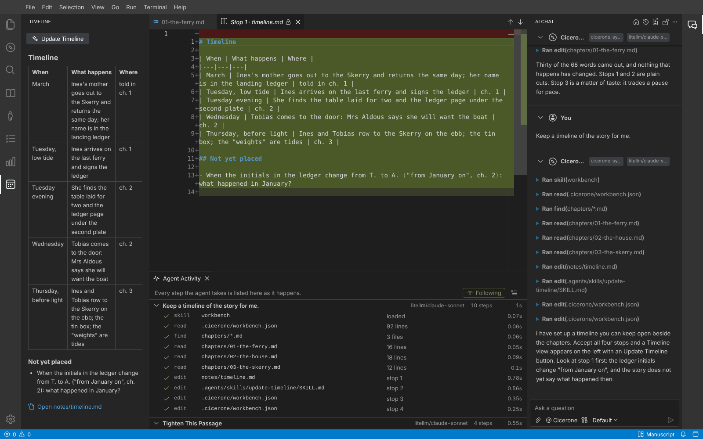
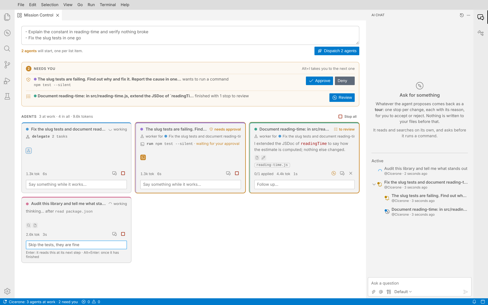
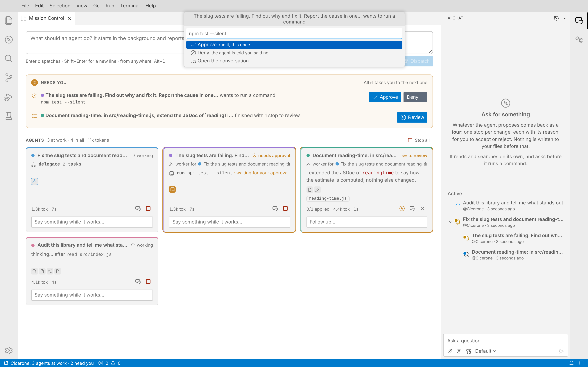
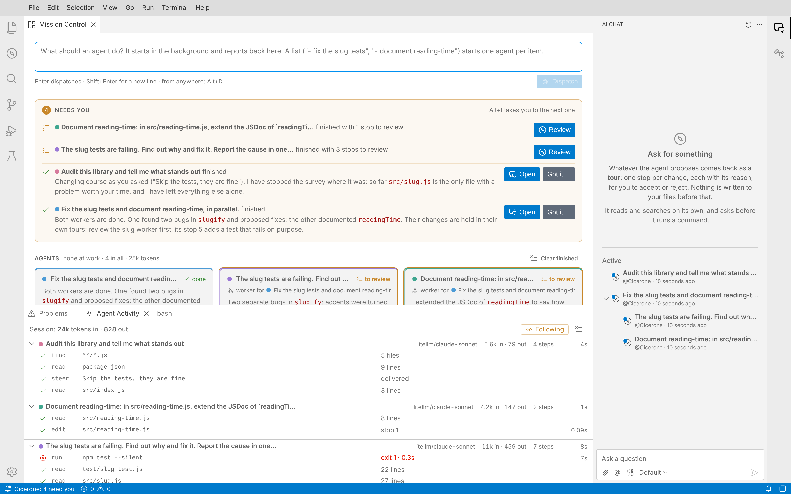

# Cicerone

An agentic workbench in which the agent shows its work.

A *cicerone* is the guide who walks you through a collection and tells you what you are looking at. That is the job
this editor gives the agent: whatever it does to your files, it takes you through it, stop by stop, and you decide.

Cicerone is a prototype built on [Eclipse Theia 1.77 and Theia AI](https://theia-ide.org/theia-ai/). It is for code, and
equally for manuscripts, contracts and copy on a desk; a workspace can reshape the editor for the work done in it.



## The four ideas

### 1. The tour: work arrives as stops, not as scroll-back

Every change the agent proposes and every place it wants you to see becomes a numbered **stop**:

- a **change** carries the agent's one-sentence reason, a word-level preview, and opens as a diff in the editor;
- a **pointer** (`show`) marks a place that matters but needs no change: the cause of a bug, the clause a reference points at;
- a **result** records a command the agent ran, with its exit code and output.

You step through with <kbd>Alt</kbd>+<kbd>J</kbd> / <kbd>Alt</kbd>+<kbd>K</kbd>, accept with <kbd>Alt</kbd>+<kbd>Enter</kbd>,
reject with <kbd>Alt</kbd>+<kbd>Backspace</kbd>, or ask about a stop with *Discuss*. Accepting writes that one change through the
editor's own undo stack; an accepted stop can be undone. A stop whose text has changed underneath it goes *stale* instead
of being applied blindly. Tours survive a reload.

**The checkpoint.** Models do not wait: they propose a fix and run the tests in the same breath. A command only sees
what is in the files, so when the agent calls `run` while proposals of the conversation are still held, the command is
held too. The tour says what the agent is waiting to do, you decide the stops (or choose *Run without them*), and then
the command runs and the model is told what you accepted and rejected. If a turn ended with proposals on the table,
*Let the agent wrap up* hands your decisions back in one click, with the instruction to finish only what the request
still needs; otherwise they travel with your next message.

Stops are a side effect of the agent working (its `edit`, `show` and `run` calls), never a report written afterwards, so the
tour cannot drift from what actually happened.

**One dial of trust.** *Changes wait for you* (default): nothing is written until you accept. *Written, then reviewed*: the
agent writes at once, so it can test its own work, and the tour is the record you review and undo from. In between, the
setting `cicerone.review.writeAtOnce` lists globs (`notes/**`, `test/**`) that are written at once even in the cautious
mode. These are rules you set, not the model's opinion of its own confidence, and they are read from your user settings
only: a workspace file is something the agent can edit, and it must not be able to widen its own leash.

### 2. The ledger: what the agent is doing, as data

The **Agent Activity** panel lists every step of every turn: tool, target, outcome, duration, and the tokens the turn cost.
A row opens the file at the lines read, or the stop it produced. A step waiting for your approval says so, in the panel
and in the status bar. With **Following** on, the editor shows each file as the agent reads or changes it, the way you
would watch a colleague's screen.

The ledger is derived from the chat model, so tools from MCP servers appear in it too.



### 3. The workbench is a file, so the agent can shape the editor

`.cicerone/workbench.json` in a workspace describes views, panel layout and context-menu actions. It is hot-reloaded.

```json
{
  "title": "Contract",
  "views": [
    { "id": "defined-terms", "title": "Defined Terms", "kind": "matches", "icon": "symbol-key",
      "files": "**/*.md", "pattern": "[\"“]([A-Z][^\"”]+)[\"”] (?:means|has the meaning)", "group": "none" }
  ],
  "actions": [
    { "id": "check-terms", "label": "Check Defined Terms", "on": "file", "skill": "defined-terms-check" }
  ],
  "layout": { "left": ["clauses", "defined-terms", "tour", "explorer"], "hide": ["terminal", "debug", "scm"] }
}
```

Five declarative view kinds cover a lot of ground: `outline` (headings across files), `matches` (a regular expression, grouped by file
or by match), `files` (cards from front matter), `counts` (words or lines against a target), `document` (a rendered
markdown file). For everything else there is a sixth, `custom` (below). An action sends the agent a request, usually naming a **skill**: a `SKILL.md` under `.agents/skills/`,
the [Agent Skills](https://agentskills.io) layout that Theia's skill service already scans.

Because it is a file, the agent reshapes the editor with the same `edit` tool it uses for everything else, you review the
reshaping as ordinary stops, and a colleague who opens the folder gets the same workbench. How to do it is itself a
built-in skill (`workbench`) that costs one line of prompt until someone asks. Proposed workbench files and skills are
validated while the agent writes them, and the problems go back to the model in the tool result.

**Custom views: when no kind fits, the agent writes one.** A `custom` view is an HTML file under `.cicerone/views/`
with its own script, so a question the five kinds cannot answer gets a view of its own without rebuilding the editor:
which character is in which scene, which clause cites which, a dependency graph. Asked *Show me who appears in which
scene*, the agent writes a grid of scenes and characters. A dot opens the scene, the grid redraws as you write, and it
flags a character who turns up before the chapter their character file names.



```json
{ "id": "on-stage", "title": "On Stage", "kind": "custom", "area": "bottom",
  "file": ".cicerone/views/scenes.html", "files": "{chapters,characters}/*.md" }
```

The view is code that the agent wrote, so it is fenced in:

- **It runs only once you allow it.** The view first shows what it is and what it may read, with *Run this view* and
  *Read the code*. Consent is stored in the browser for that exact content, which the agent cannot write, and any
  change to the file asks again.
- **It has no network.** It runs in two nested sandboxed frames. The outer one has a policy that allows nothing to be
  fetched, and that policy also governs where the inner frame may navigate. Fetch, images, sockets, child frames, meta
  refresh and navigating itself away are all blocked; the probe used to check this got every one through when only one
  frame was used. Neither frame can reach the editor's page, storage or cookies.
- **It sees only what it declares.** Its one way out is `window.cicerone`: list files, read, search, open a file at a
  line, run an action the workbench already declares, and be told when files change. Paths are checked on the editor's
  side: inside the workspace, not hidden (`.env` and `.git` are refused), and inside the view's `files` glob.
- **Its errors reach the agent.** An uncaught error, or a blocked navigation, appears above the view with *Ask the
  agent to fix it*, which sends the error and its stack to the agent. While the agent writes a view, it is told when
  the code reaches for the network, browser storage or `fetch`.

Colours and fonts come from the editor theme as CSS variables (`--fg`, `--dim`, `--accent`, `--chart-1`…), and follow it
when the theme changes. How to write a view is part of the `workbench` skill, so it costs nothing until it is needed.

*Cicerone: Set Up This Workspace For…* writes a starting point: software, fiction manuscript, contracts, copy-editing,
or "something else", which hands your one-sentence description to the agent.

| Contract: findings as stops | Manuscript: a prose edit |
|---|---|
|  |  |
| **Actions in the context menu** | **A view the agent built on request** |
|  |  |

### 4. The fleet: many agents, one queue of what needs you

A chat shows one agent as scroll-back and leaves it to you to notice the moment it needs you. That stops working at
the second agent. **Mission Control** (<kbd>Alt</kbd>+<kbd>O</kbd>) is the view from above: every conversation is an agent on a
board, and everything that waits for you, anywhere, is one queue.



- **Dispatch.** Type a task into the box, or press <kbd>Alt</kbd>+<kbd>D</kbd> anywhere, and an agent starts in the background:
  the chat stays where it is, the editor is not taken over. A list starts one agent per item. *Dispatch an Agent on
  This…* in the editor's context menu sends the selection along.
- **Needs you.** A command to approve, a checkpoint waiting for review, a failure, a finished task: each is a row in
  the queue, most blocking first, with the action on the row (*Approve*, *Review*, *Open*). <kbd>Alt</kbd>+<kbd>I</kbd> takes you
  to the next one from wherever you are; for an approval it asks in place, showing the command that would run. The count
  is in the status bar and in the window title, and `cicerone.notify` adds a desktop notification when the window is in
  the background.
- **Steer without stopping.** Each card has an input. While the agent works, <kbd>Enter</kbd> sends your message with the
  result of the step it is on, the one moment a working model reads anything new, and it changes course from there;
  <kbd>Alt</kbd>+<kbd>Enter</kbd> queues the message as its next request. No interrupting, no waiting for the turn to end.
  <kbd>Alt</kbd>+<kbd>S</kbd> does the same from the keyboard. The ledger records what you said and when it was delivered.
- **Fan-out by the agent.** With the `delegate` tool an agent hands independent parts of a job to up to six workers.
  They run at the same time, each with its own conversation, tour and card; the parent gets a paragraph per worker,
  not a transcript. Workers cannot delegate further. A command of the parent waits for the review of its workers' proposals too.
- **Each agent at a glance.** State, the step it is on, a trail of the steps of its turn, the files it changed (flagged
  when another agent changed the same file), stops applied, tokens, time. Each agent has a colour that follows it into
  the ledger. Following, and the tour taking the stage, apply to the conversation you have open; background agents
  wait until you ask for them.

Every agent has its own review checkpoint, so two of them can wait for you at once and each carries on when *its*
stops are decided.

| Approving from the keyboard | The ledger, per agent, with a steering message |
|---|---|
|  |  |

## The harness

One agent, no modes, seven tools:

| tool | does | result is kept small by |
|---|---|---|
| `read` | reads a file, pending proposals applied | 400-line pages; a header only when there is more |
| `find` | text or file-name search | an excerpt around each match, 60 results, "n more not shown" |
| `edit` | one exact-match replacement, with a `why` | one line back: "Held as proposal; stop 3." |
| `show` | points at a place, with a `why` | one line back |
| `run` | shell command, always asks first | exit code, first 12 and last 60 lines |
| `skill` | loads a skill's instructions | nothing is loaded until asked for |
| `delegate` | runs independent tasks on parallel workers | each worker's closing words, nothing else |

Other things done for the token bill:

- The system prompt says only what a model would not do unprompted (about 330 tokens).
- The prompt and tool definitions never change within a session, and the note about your cursor and selection is stored
  with each request rather than recomputed, so earlier messages stay byte-identical and provider prompt caching keeps hitting.
- Skills cost one line each until loaded.
- A context action starts a fresh conversation instead of dragging the history along. So does every dispatched agent and every worker,
  and they are named after their task instead of asking the model for a title.
- What you decided in review reaches the agent as one line on your next message ("accepted 1, 2; rejected 3").

**Measured.** Fixed overhead of one request (system prompt plus tool definitions), same prompt, same build, captured at the
gateway and counted as characters / 4:

| agent | system prompt | tools | fixed overhead |
|---|---|---|---|
| Cicerone | 1,325 chars | 7 tools, 3,584 chars | about 1,230 tokens |
| Theia IDE's Coder, Agent Mode (`@theia/ai-ide` 1.77) | 10,621 chars | 14 tools, 19,946 chars | about 7,640 tokens |

This compares fixed cost only. Coder does things Cicerone does not (diagnostics, tasks, launch configurations, a to-do
list), and nothing here says anything about how well either agent works. To repeat it: start the mock gateway with
`MOCK_GATEWAY_DUMP=/tmp/request.json` and read the file after a request.

## Providers

- **LiteLLM gateway**: F1 → *Cicerone: Connect a LiteLLM Gateway…* asks for URL and key, tries them, and saves them only
  if the gateway answers. The same values are in the AI Configuration view under *Providers & Models › LiteLLM Gateway*
  (`ai-features.liteLlm.baseUrl`, `ai-features.liteLlm.apiKey`), or `LITELLM_BASE_URL` / `LITELLM_API_KEY` in the environment (used only after you confirm). Every chat model
  the gateway serves is discovered through `/v1/models` and `/model/info` and offered to the agent; embedding and other
  non-chat models are left out. Any OpenAI-compatible endpoint works; LiteLLM additionally tells Cicerone which models are chat models.
  The models are registered through Theia's OpenAI provider with the gateway as endpoint, so streaming, tool calling and
  retries are Theia's implementation, not a second one.
- **Directly**: Theia's Anthropic, OpenAI, Google and Ollama providers are part of the build, as is MCP. They are set up
  in the AI Configuration view (F1 → *Open AI Configuration*, or the chat's menu) under *Providers & Models*. For Ollama,
  list the models you have pulled under *Ollama Models*; the host defaults to `http://localhost:11434`.
- `cicerone.model` pins the agent to a model, e.g. `litellm/claude-sonnet`. Unset, the agent uses the model chosen for it in
  Theia's AI configuration, otherwise the first model the gateway offers.

## Try it

Needs Node 20 or newer and the usual toolchain for native Node modules.

```sh
npm install
npm run build
npm run download:plugins      # optional: syntax highlighting, from open-vsx.org
```

Without a model, against the scripted mock gateway:

```sh
npm run mock-gateway                          # a stand-in LiteLLM on http://127.0.0.1:4000
cp -r samples/code /tmp/postcard              # the samples get edited, so work on a copy
npm start -- /tmp/postcard                    # http://127.0.0.1:3000
```

The status bar says *No model connected*. Click it (or F1 → **Cicerone: Connect a LiteLLM Gateway…**), enter
`http://127.0.0.1:4000` and leave the key empty. Then ask in the chat:
*The slug tests are failing. Find out why and fix it.* The mock plays a scripted model, but everything after it is real:
the tools run, the files change, `npm test` passes or fails on its own merits.

| sample | set up for | then |
|---|---|---|
| `samples/code` | nothing needed | ask as above; after accepting, ask *Run the tests again.* To see the checkpoint: *Fix the slug tests in one go.* |
| `samples/code`, several agents | nothing needed | in Mission Control: *Fix the slug tests and document reading-time, in parallel.* (the agent delegates to two workers), then *Audit this library* and type into its card while it reads |
| `samples/contract` | Contracts and legal drafting | context menu in `services-agreement.md`: *Check Defined Terms*, *Check Cross-References* |
| `samples/manuscript` | Fiction manuscript | select the second paragraph of chapter 1, context menu: *Tighten This Passage*; or ask *Keep a timeline of the story for me.* For a custom view: *Show me who appears in which scene.* |

With a real gateway, run the same command with its URL and key and open your own folder.

## How it is built

```
applications/browser     the Theia application (browser target)
packages/litellm         gateway discovery: one URL in, registered models out
packages/core            the agent, its seven tools, tour, ledger, follow mode, the fleet and Mission Control
packages/shape           workbench.json: views (custom views in a sandbox among them), layout, actions, profiles, the workbench skill
tools/mock-gateway       an OpenAI-compatible server that plays scripted conversations
samples/                 a small library, a contract, three chapters of a novel
```

What comes from Theia AI and is used as it is: the chat view and session model, the tool-calling loop and tool
confirmation, the providers, skill discovery, MCP, the AI Configuration view and the history view. The AI Configuration
view comes with `@theia/ai-ide`, which also brings the Theia IDE's own chat agents (Coder, Architect, Orchestrator and
others). Those ship switched off: Cicerone is the only agent in the chat until you enable another under *Agents*, which
also makes it easy to compare them on the same task.

What Cicerone adds: the fleet (the board, the attention queue, dispatching, steering, and a `delegate` tool whose workers are
ordinary conversations; Theia's own delegation tool is not used), the tour and its proposal model (Theia's change sets are per file; a tour is per change, ordered,
and carries reasons and non-change stops), the ledger and follow mode, the seven-tool agent, gateway model discovery, and
the workbench description with its views, actions and profiles.

## State of the prototype

Tested, by driving the built application in headless Chrome: the three sample workflows end to end, including approval,
per-stop accept, reject and undo, a second turn, profile setup, all five view kinds, context actions, the agent adding a
view, action and skill to a workbench, reload, and the first-run path from an empty configuration (settings view,
connecting a gateway with a wrong and then a right URL, first chat); and the fleet: two agents dispatched from a list, approval from
the board and from the keyboard, delegation to two workers, steering and queueing a message, two agents at their checkpoints at once,
stopping, dispatching on a selection. The fleet runs used the mock directly, without LiteLLM in between. The model side of the earlier ones was the scripted mock, reached through
a real LiteLLM 1.109 proxy with a master key, so discovery, authentication, streaming and tool calls crossed the real
gateway.

Barely tested: **real models.** One session with Gemma through Ollama so far; it showed that a model runs the tests
before the review, which is what the checkpoint now handles. The system prompt, the tool descriptions and the profile
skills are otherwise unproven; expect to tune them. Also untested: the Anthropic, OpenAI, Google and Ollama providers
in this build, MCP tools in the ledger, Windows and macOS, large repositories.

Known gaps:

- Custom views: tested in Chromium only. The sandbox relies on the outer frame's policy governing the inner frame's
  navigation, as the CSP standard says; Firefox and Safari are not checked yet. Consent is per browser, not per
  person, and is lost when site data is cleared. A view cannot keep state between reloads except in a workspace file,
  and it has no way to write one: it can only run an action that asks the agent. Keyboard shortcuts do not work
  while focus is inside a view.

- The ledger is rebuilt per window session; after a reload it starts empty (tours and chats are restored). The board is built from the
  ledger, so it starts empty too.
- Agents share one working tree. Held proposals of all agents are replayed in the order they were made, so a second agent reads the
  first one's proposals as if applied; the board flags files two agents changed, but there is no isolation (worktrees) between them.
- Steering reaches an agent with the result of one of Cicerone's own tools; during a step of an MCP tool it waits for the next one,
  and if the turn ends first it is sent as the next request.
- A real model has not been steered or asked to delegate yet; how well models follow the steering line and split work is unproven.
- Tours are kept in the browser's local storage for the workspace, not in the workspace itself.
- One workspace root. No tool to delete or rename files (the agent can ask to `run` a command).
- A stop is one exact replacement. "Accept all changes like this one" does not exist yet.
- Browser application only; an Electron target is not set up.
- The chat shows the literal request an action sent ("Use the skill …"), not the action's label.
- The `license` fields mirror Theia's (EPL-2.0 OR GPL-2.0 with Classpath exception) as a placeholder; there is no LICENSE file yet.
