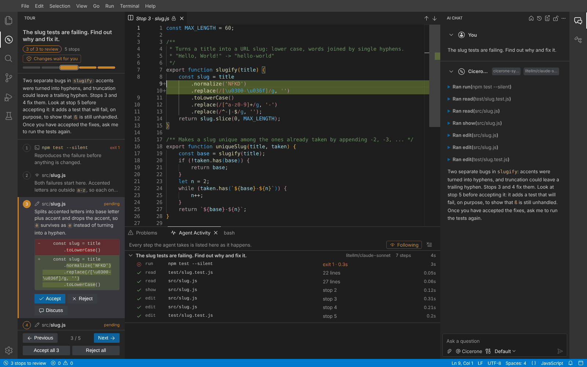
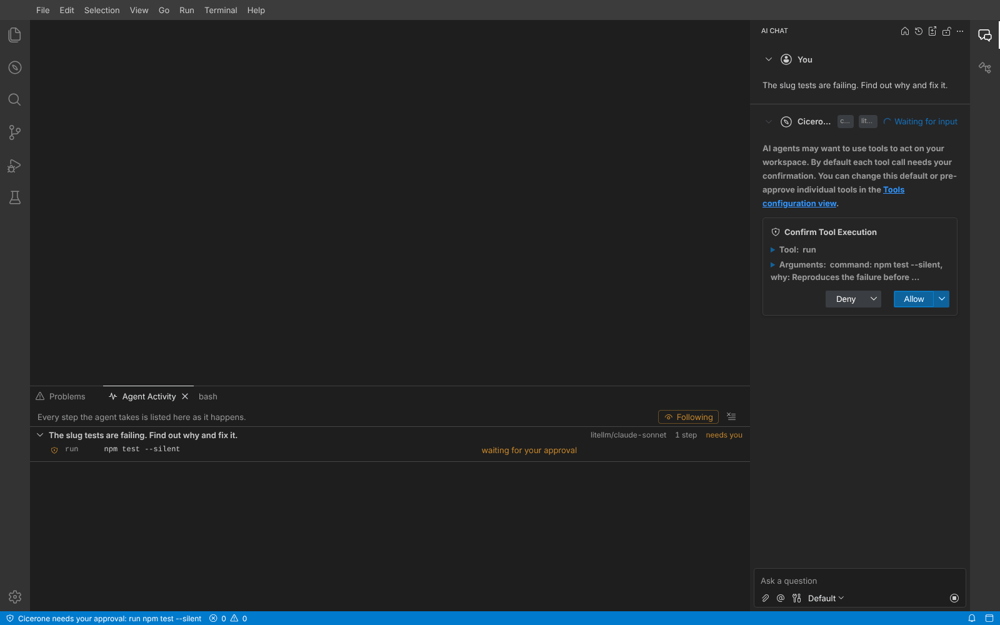
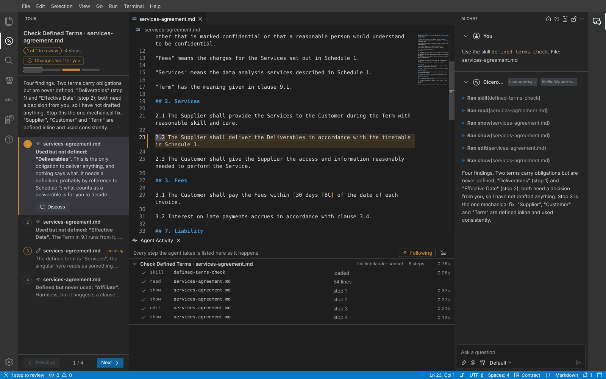
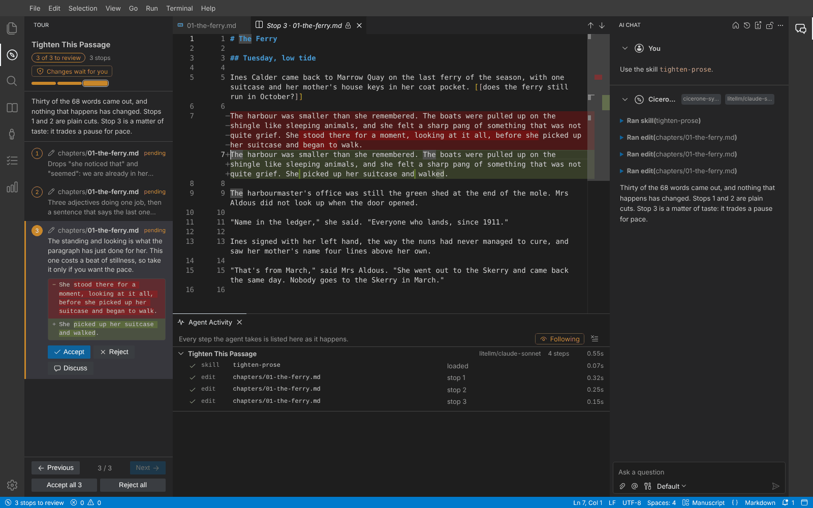
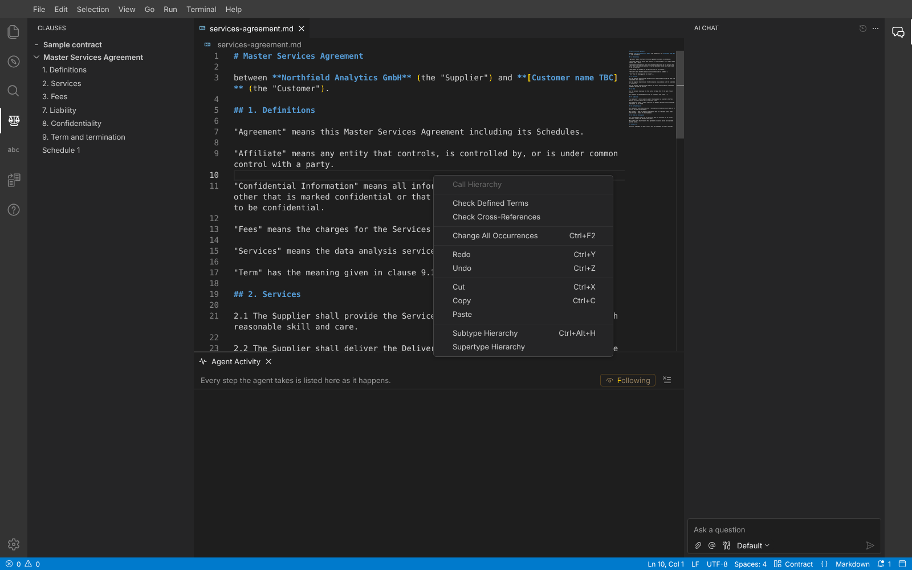
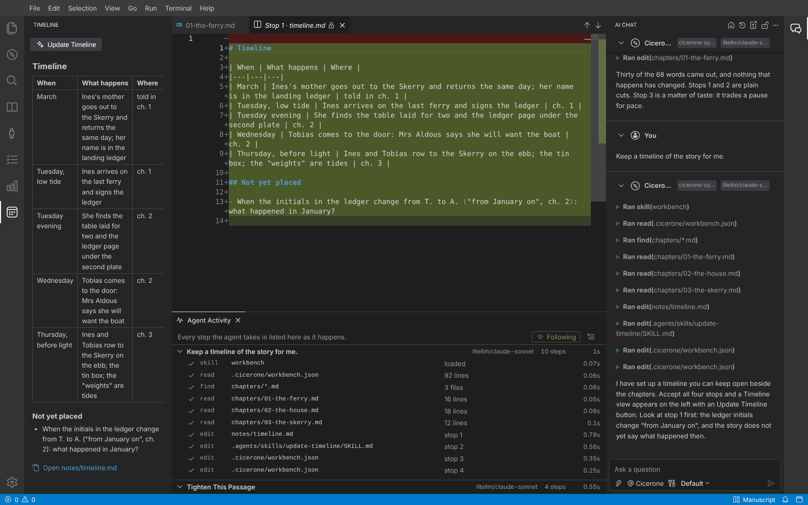

# Cicerone

An agentic workbench in which the agent shows its work.

A *cicerone* is the guide who walks you through a collection and tells you what you are looking at. That is the job
this editor gives the agent: whatever it does to your files, it takes you through it, stop by stop, and you decide.

Cicerone is a prototype built on [Eclipse Theia 1.77 and Theia AI](https://theia-ide.org/theia-ai/). It is for code, and
equally for manuscripts, contracts and copy on a desk; a workspace can reshape the editor for the work done in it.



## The three ideas

### 1. The tour: work arrives as stops, not as scroll-back

Every change the agent proposes and every place it wants you to see becomes a numbered **stop**:

- a **change** carries the agent's one-sentence reason, a word-level preview, and opens as a diff in the editor;
- a **pointer** (`show`) marks a place that matters but needs no change: the cause of a bug, the clause a reference points at;
- a **result** records a command the agent ran, with its exit code and output.

You step through with <kbd>Alt</kbd>+<kbd>J</kbd> / <kbd>Alt</kbd>+<kbd>K</kbd>, accept with <kbd>Alt</kbd>+<kbd>Enter</kbd>,
reject with <kbd>Alt</kbd>+<kbd>Backspace</kbd>, or ask about a stop with *Discuss*. Accepting writes that one change through the
editor's own undo stack; an accepted stop can be undone. A stop whose text has changed underneath it goes *stale* instead
of being applied blindly. Tours survive a reload.

Stops are a side effect of the agent working (its `edit`, `show` and `run` calls), never a report written afterwards, so the
tour cannot drift from what actually happened.

**One dial of trust.** *Changes wait for you* (default): nothing is written until you accept. *Written, then reviewed*: the
agent writes at once, so it can test its own work, and the tour is the record you review and undo from. In between, the
setting `cicerone.review.writeAtOnce` lists globs (`notes/**`, `test/**`) that are written at once even in the cautious
mode. These are rules you set, not the model's opinion of its own confidence, and they are read from your user settings
only: a workspace file is something the agent can edit, and it must not be able to widen its own leash.

### 2. The ledger: what the agent is doing, as data

The **Agent Activity** panel lists every step of every turn: tool, target, outcome, duration, and the tokens the turn cost.
A row opens the file at the lines read, or the stop it produced. A step waiting for your approval says so, in the panel
and in the status bar. With **Following** on, the editor shows each file as the agent reads or changes it, the way you
would watch a colleague's screen.

The ledger is derived from the chat model, so tools from MCP servers appear in it too.



### 3. The workbench is a file, so the agent can shape the editor

`.cicerone/workbench.json` in a workspace describes views, panel layout and context-menu actions. It is hot-reloaded.

```json
{
  "title": "Contract",
  "views": [
    { "id": "defined-terms", "title": "Defined Terms", "kind": "matches", "icon": "symbol-key",
      "files": "**/*.md", "pattern": "[\"“]([A-Z][^\"”]+)[\"”] (?:means|has the meaning)", "group": "none" }
  ],
  "actions": [
    { "id": "check-terms", "label": "Check Defined Terms", "on": "file", "skill": "defined-terms-check" }
  ],
  "layout": { "left": ["clauses", "defined-terms", "tour", "explorer"], "hide": ["terminal", "debug", "scm"] }
}
```

Five view kinds cover a lot of ground: `outline` (headings across files), `matches` (a regular expression, grouped by file
or by match), `files` (cards from front matter), `counts` (words or lines against a target), `document` (a rendered
markdown file). An action sends the agent a request, usually naming a **skill**: a `SKILL.md` under `.agents/skills/`,
the [Agent Skills](https://agentskills.io) layout that Theia's skill service already scans.

Because it is a file, the agent reshapes the editor with the same `edit` tool it uses for everything else, you review the
reshaping as ordinary stops, and a colleague who opens the folder gets the same workbench. How to do it is itself a
built-in skill (`workbench`) that costs one line of prompt until someone asks. Proposed workbench files and skills are
validated while the agent writes them, and the problems go back to the model in the tool result.

*Cicerone: Set Up This Workspace For…* writes a starting point: software, fiction manuscript, contracts, copy-editing,
or "something else", which hands your one-sentence description to the agent.

| Contract: findings as stops | Manuscript: a prose edit |
|---|---|
|  |  |
| **Actions in the context menu** | **A view the agent built on request** |
|  |  |

## The harness

One agent, no modes, six tools:

| tool | does | result is kept small by |
|---|---|---|
| `read` | reads a file, pending proposals applied | 400-line pages; a header only when there is more |
| `find` | text or file-name search | an excerpt around each match, 60 results, "n more not shown" |
| `edit` | one exact-match replacement, with a `why` | one line back: "Held as proposal; stop 3." |
| `show` | points at a place, with a `why` | one line back |
| `run` | shell command, always asks first | exit code, first 12 and last 60 lines |
| `skill` | loads a skill's instructions | nothing is loaded until asked for |

Other things done for the token bill:

- The system prompt says only what a model would not do unprompted (about 260 tokens).
- The prompt and tool definitions never change within a session, and the note about your cursor and selection is stored
  with each request rather than recomputed, so earlier messages stay byte-identical and provider prompt caching keeps hitting.
- Skills cost one line each until loaded.
- A context action starts a fresh conversation instead of dragging the history along.
- What you decided in review reaches the agent as one line on your next message ("accepted 1, 2; rejected 3").

**Measured.** Fixed overhead of one request (system prompt plus tool definitions), same prompt, same build, captured at the
gateway and counted as characters / 4:

| agent | system prompt | tools | fixed overhead |
|---|---|---|---|
| Cicerone | 1,049 chars | 6 tools, 3,118 chars | about 1,040 tokens |
| Theia IDE's Coder, Agent Mode (`@theia/ai-ide` 1.77) | 10,621 chars | 14 tools, 19,946 chars | about 7,640 tokens |

This compares fixed cost only. Coder does things Cicerone does not (diagnostics, tasks, launch configurations, a to-do
list), and nothing here says anything about how well either agent works. To repeat it: start the mock gateway with
`MOCK_GATEWAY_DUMP=/tmp/request.json` and read the file after a request.

## Providers

- **LiteLLM gateway**: set `ai-features.liteLlm.baseUrl` (and `ai-features.liteLlm.apiKey` if the gateway wants one) in the
  settings, or `LITELLM_BASE_URL` / `LITELLM_API_KEY` in the environment (used only after you confirm). Every chat model
  the gateway serves is discovered through `/v1/models` and `/model/info` and offered to the agent; embedding and other
  non-chat models are left out. Any OpenAI-compatible endpoint works; LiteLLM additionally tells Cicerone which models are chat models.
  The models are registered through Theia's OpenAI provider with the gateway as endpoint, so streaming, tool calling and
  retries are Theia's implementation, not a second one.
- **Directly**: Theia's Anthropic, OpenAI, Google and Ollama providers are part of the build, as is MCP.
- `cicerone.model` pins the agent to a model, e.g. `litellm/claude-sonnet`. Unset, the agent uses the model chosen for it in
  Theia's AI configuration, otherwise the first model the gateway offers.

## Try it

Needs Node 20 or newer and the usual toolchain for native Node modules.

```sh
npm install
npm run build
npm run download:plugins      # optional: syntax highlighting, from open-vsx.org
```

Without a model, against the scripted mock gateway:

```sh
npm run mock-gateway                          # a stand-in LiteLLM on http://127.0.0.1:4000
cp -r samples/code /tmp/postcard              # the samples get edited, so work on a copy
npm start -- /tmp/postcard                    # http://127.0.0.1:3000
```

In the settings set **LiteLLM gateway URL** to `http://127.0.0.1:4000`, then ask in the chat:
*The slug tests are failing. Find out why and fix it.* The mock plays a scripted model, but everything after it is real:
the tools run, the files change, `npm test` passes or fails on its own merits.

| sample | set up for | then |
|---|---|---|
| `samples/code` | nothing needed | ask as above; after accepting, ask *Run the tests again.* |
| `samples/contract` | Contracts and legal drafting | context menu in `services-agreement.md`: *Check Defined Terms*, *Check Cross-References* |
| `samples/manuscript` | Fiction manuscript | select the second paragraph of chapter 1, context menu: *Tighten This Passage*; or ask *Keep a timeline of the story for me.* |

With a real gateway, point the same setting at it and open your own folder.

## How it is built

```
applications/browser     the Theia application (browser target)
packages/litellm         gateway discovery: one URL in, registered models out
packages/core            the agent, its six tools, tour, ledger, follow mode
packages/shape           workbench.json: views, layout, actions, profiles, the workbench skill
tools/mock-gateway       an OpenAI-compatible server that plays scripted conversations
samples/                 a small library, a contract, three chapters of a novel
```

What comes from Theia AI and is used as it is: the chat view and session model, the tool-calling loop and tool
confirmation, the providers, skill discovery, MCP, the AI configuration and history views. Theia's own IDE agents
(`@theia/ai-ide`) are deliberately not part of the build.

What Cicerone adds: the tour and its proposal model (Theia's change sets are per file; a tour is per change, ordered,
and carries reasons and non-change stops), the ledger and follow mode, the six-tool agent, gateway model discovery, and
the workbench description with its views, actions and profiles.

## State of the prototype

Tested, by driving the built application in headless Chrome: the three sample workflows end to end, including approval,
per-stop accept, reject and undo, a second turn, profile setup, all five view kinds, context actions, the agent adding a
view, action and skill to a workbench, and reload. The model side of those runs was the scripted mock, reached through
a real LiteLLM 1.109 proxy with a master key, so discovery, authentication, streaming and tool calls crossed the real
gateway.

Not tested: **a real model has not driven this yet.** The system prompt, the tool descriptions and the profile skills are
written with care but unproven; expect to tune them. Also untested: the Anthropic, OpenAI, Google and Ollama providers
in this build, MCP tools in the ledger, Windows and macOS, large repositories.

Known gaps:

- The ledger is rebuilt per window session; after a reload it starts empty (tours and chats are restored).
- Tours are kept in the browser's local storage for the workspace, not in the workspace itself.
- One workspace root. No tool to delete or rename files (the agent can ask to `run` a command).
- A stop is one exact replacement. "Accept all changes like this one" does not exist yet.
- Browser application only; an Electron target is not set up.
- The chat shows the literal request an action sent ("Use the skill …"), not the action's label.
- The `license` fields mirror Theia's (EPL-2.0 OR GPL-2.0 with Classpath exception) as a placeholder; there is no LICENSE file yet.
